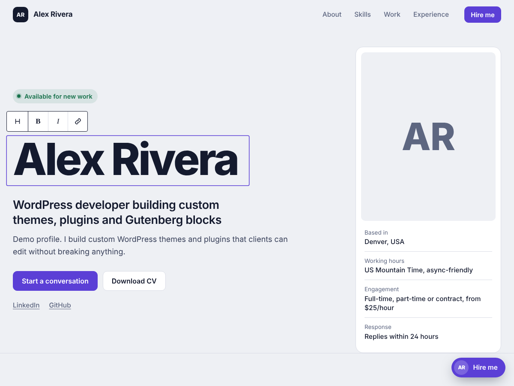
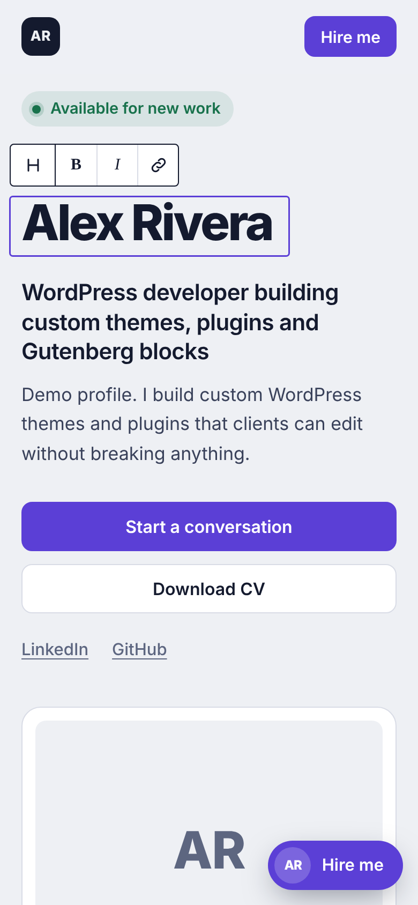

# Hire Profile

A one-page WordPress theme for a developer's job-seeking profile: who you are, what you build, your work and how to reach you. Everything is edited in the WordPress Customizer, with no page builder and no paid plugins.

*Screenshots use a fictional demo profile.*

## Features

- **Profile in the Customizer:** name, headline, summary, photo, availability, location, time zone, rates, skills, services, experience and links under **Appearance → Customize → Profil Pelamar**.
- **Portfolio post type:** add projects with a live link, code link, result, tech used and your role. Each project gets its own page.
- **Contact form with inbox:** messages are saved in the dashboard (*Pesan Masuk*) as well as emailed, so nothing is lost.
- **Short intro dialog:** an optional floating button and introduction dialog, opened once automatically and then hidden for 7 days.
- **English or Indonesian labels:** switch the public labels in the Customizer.
- **Schema.org Person data** for search engines.
- **Fast and accessible:** one small script, system font option, visible keyboard focus, reduced-motion support, responsive down to small phones.

| Mobile |
|---|
|  |

## Requirements

- WordPress 6.0 or newer
- PHP 7.4 or newer

## Installation

1. Download this repository as a ZIP (**Code → Download ZIP**).
2. In WordPress, go to **Appearance → Themes → Add New → Upload Theme** and upload the ZIP.
3. Activate **Hire Profile**.
4. Fill in your profile under **Appearance → Customize → Profil Pelamar**.
5. Add projects under **Portofolio → Add New**.

The default text is placeholder copy. Replace it with your own facts, and only use numbers you can show.

## License

GPL-2.0-or-later. See [LICENSE](LICENSE).

## Author

**Jansen Great** · [jansengreat.globalcentreone.com](https://jansengreat.globalcentreone.com) · Global Faith Connection LLC, Wyoming, USA
